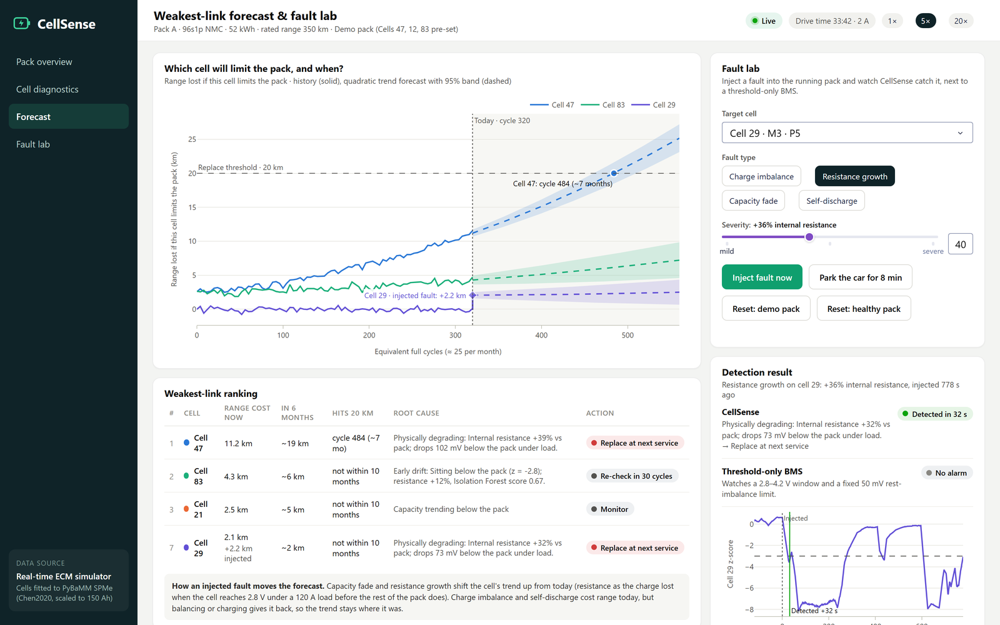
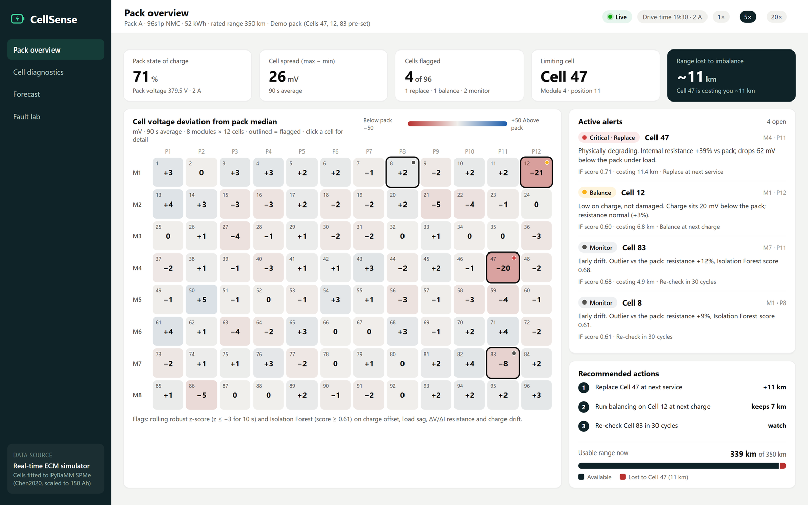
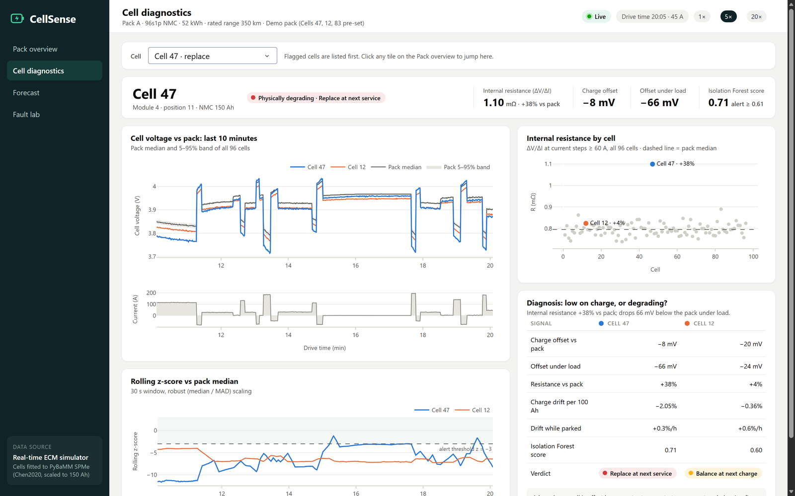

# CellSense

**Find the weakest cell in an EV battery pack before it costs you range.** Team BitStorm, problem statement #5:
EV battery cell imbalance detection.

[](https://cell-sense-seven.vercel.app)

[](LICENSE)

CellSense compares every cell of a 96-cell pack with the rest of the pack, every second, and turns what it finds into
plain actions: which cell is weak, whether it needs **balancing** or **replacing**, when it will become the pack's
limiting cell, and how many **km of range** it is costing the driver. Detection and diagnosis need only the cell
voltages and pack current that every BMS already measures; the km figures and the forecast also need a capacity
estimate for each cell, which in this demo comes from the simulator.



*Forecast and fault lab. Cell 29 was injected with +36% internal resistance mid-drive: CellSense flagged it in 32 s
and called it "replace", while the threshold-only BMS beside it raised no alarm.*

## Try it in a minute

1. Open the **[live demo](https://cell-sense-seven.vercel.app)**. The first load takes about 10 s while the host wakes up.
2. **Pack overview** shows the demo pack: Cell 47 is degrading and costing about 11 km, Cell 12 is low on charge, and
   Cell 83 is drifting early.
3. Open **Forecast**, pick a cell, a fault type and a severity in the fault lab, and press **Inject fault now**. Watch
   CellSense's detection result next to a threshold-only BMS, and the cell join the weakest-link ranking with the range
   it costs.

The hosted demo runs one pack per server instance, so a fault you inject may not show if a later request reaches a
different instance. For the full experience, run it locally (see [Quick start](#quick-start-windows-python-312)).

## Highlights

- **96.5%** of 200 injected faults flagged; a threshold-only BMS with a 50 mV rest limit caught **1%** of the same faults.
- Charge imbalance and resistance growth first flagged in a median of about **20 s**; on the demo pack, "replace" is
  called a median of **95 s** of driving after a resistance fault.
- **89%** precision against the simulator's ground truth, or 0.11 false alarms per 96-cell pack at the end of a trip.
- Ageing model and forecast checked on **15 real cells** from NASA PCoE and Oxford; the forecast warned early for 13 of 15.
- About **1 ms** per second of data for all 96 cells on a laptop.

Everything runs in software: a real-time cell model fitted to a physics-based PyBaMM cell drives the live dashboard,
the fault lab and the benchmark, and a full PyBaMM + liionpack pack run is included for replay. All results are from
simulation, except the ageing checks on real cells (see [Honest notes](#honest-notes)).

## Quick start (Windows, Python 3.12)

In PowerShell, inside the cloned `CellSense` folder (if `python --version` is not 3.12, use `py -3.12 -m venv .venv`):

```powershell
python -m venv .venv
.venv\Scripts\python -m pip install -r requirements-full.txt
.venv\Scripts\python -m cellsense dashboard
```

On macOS/Linux use `python3.12 -m venv .venv` and `.venv/bin/python`; in Git Bash on Windows use `.venv/Scripts/python`.
In the commands further down, `python` means this venv's Python (or activate the venv first); in cmd, leave out their
`# ...` comments.

`requirements.txt` is the slim dashboard runtime (what a web host installs). `requirements-full.txt` adds the
research stack: PyBaMM + liionpack (physics backend, `calibrate`, `simulate`), pandas, and pytest.

Open http://127.0.0.1:8050. The first start trains the anomaly model (about a minute) if
`cellsense/data/iforest.joblib` is missing. Stop the server with Ctrl+C in that terminal; if port 8050 is taken,
add `--port 8051`.

> The versions in `requirements-full.txt` are pinned on purpose. On Windows 11 with Smart App Control, newer builds of
> pandas (3.x) and PyBaMM's solver package (pybammsolvers 0.10+) are blocked from loading.

## Deploying the dashboard (Vercel)

`app.py` at the repo root is the WSGI entrypoint: it builds the dashboard and exposes the Flask server as `app`,
which Vercel's Python runtime serves. Vercel installs only `requirements.txt` (about 340 MB, inside the 500 MB
Python function limit) and `.vercelignore` keeps reports, tests, data and screenshots out of the bundle.

Serverless functions are frozen between requests, so on Vercel the simulation advances on each request (by the
time elapsed since the last one, at most 2 simulated minutes per request) instead of in a background thread.
Each function instance keeps its own pack, so if Vercel runs several instances at once, viewers can see different
packs and an injected fault only shows on the instance that received it. For a single always-on demo, a host that
runs a long-lived process (e.g. `python -m cellsense dashboard --host 0.0.0.0`) avoids that.

## What is in the box

| Feature | Where it lives |
|---|---|
| **Detect**: rolling z-scores vs the pack median + Isolation Forest | `cellsense/analytics/engine.py` (robust median/MAD z, 30 s window, 10 s persistence), `analytics/anomaly.py` |
| **Diagnose**: ΔV/ΔI internal resistance → balance vs replace | `engine.py` (resistance from current steps), `analytics/diagnosis.py` (rules) |
| **Forecast**: which cell limits the pack next, and when; faults injected in the lab fold in live | `analytics/forecast.py` (quadratic trend + 95% band per cell; `fault_effect` / `apply_effects` for injected faults) |
| **Translate**: range lost in km | `analytics/range_impact.py` |
| PyBaMM + liionpack 96-cell pack with injected faults | `sim/physics.py` (`python -m cellsense simulate`) |
| Real-time simulator for the live demo, fitted to PyBaMM | `sim/ecm.py`, `sim/calibrate.py` (`python -m cellsense calibrate`) |
| Faults: charge imbalance, resistance growth, capacity fade, self-discharge | `sim/faults.py` |
| Threshold-only BMS baseline (2.8–4.2 V window, 50 mV rest-imbalance limit), shown next to CellSense | `engine.py` |
| Dashboard: pack overview, cell diagnostics, forecast with the fault lab beside it, fault lab with injection log | `cellsense/dashboard/` (Plotly Dash), see [The dashboard](#the-dashboard) |
| Benchmark: detection delay, precision/recall, diagnosis accuracy, forecast error | `validation/benchmark.py` → `reports/benchmark.md` |
| Validation against NASA PCoE and Oxford ageing data | `validation/datasets.py` → `reports/validation.md` |

## The dashboard

| Page | What it shows |
|---|---|
| Pack overview | State of charge, cell spread, cells flagged, the limiting cell and the range it costs; a heatmap of every cell's deviation from the pack median (8 modules × 12 cells, click a cell for detail); recommended actions and active alerts |
| Cell diagnostics | One cell against the pack: voltage vs the pack band over the last 10 minutes, rolling z-score, internal resistance of every cell, and the evidence behind the diagnosis (resistance, charge offset at rest and under load, Isolation Forest score) |
| Forecast | Which cell will limit the pack and when it reaches the 20 km replace threshold, the weakest-link ranking, and the fault lab with a live detection result beside it, so a fault can be injected while watching the forecast |
| Fault lab | The same controls with a wider detection chart, plus a log of the last six faults injected this session |

| Pack overview | Cell diagnostics |
|---|---|
|  |  |

The header switches the simulation speed (1×, 5×, 20×). In the fault lab, pick a cell, a fault type and a severity,
then press **Inject fault now**. **Park the car for 8 min** gives self-discharge the settled, parked data it needs,
and the two **Reset** buttons start a fresh demo or healthy pack.

**Injected faults move the forecast.** Within a second of an injection the chart draws the injected cell (in purple,
unless it is already one of the top two) with a jump at "Today" to what it costs now, and the ranking lists it with
its rank:

| Fault | Effect on the forecast | Lab range |
|---|---|---|
| Capacity fade | Permanent: the cell's trend moves up from today, so it reaches 20 km sooner | 2–6% → about 7–21 km |
| Resistance growth | Permanent: the range lost because the cell reaches 2.8 V under a 120 A load before the rest of the pack (read off the cell's OCV curve) | +20–60% → about 1–4 km |
| Charge imbalance | Costs range today; balancing gives it back, so the trend stays | 1–3% → about 3.5–10.5 km |
| Self-discharge | Costs the charge leaked since injection; charging gives it back, then it leaks again | grows while it leaks |

**The threshold-only BMS** shown next to CellSense in the detection result is a conventional baseline: it alarms when
a cell leaves the 2.8–4.2 V window, or sits more than 50 mV from the pack median at rest (under 8 A). Charge
imbalance, resistance growth and capacity fade at lab severities, injected into a healthy cell, stay inside those
limits while the pack is above about 20% charge, so "No alarm" there is the expected result, not a bug. It does fire
when faults add up (a 3% imbalance on the demo's already-low Cell 12 alarms within seconds), on a growing leak (at the
lab's 10%/h end, 26–45 minutes after injection in ten live-demo runs; CellSense: under 4 minutes), and on a gross fault
(the test suite's 8% charge imbalance alarmed after 21 s on its city drive, 201 s on a mixed drive and 691 s on a
highway drive; CellSense: 12–14 s). A tighter rest limit catches more (more than half of the benchmark's faults at
15 mV), but still almost no capacity fade, and a threshold cannot tell a cell to balance from one to replace.

## Commands

```bash
python -m cellsense dashboard [--mode demo|healthy] [--speed 5] [--port 8050]
python -m cellsense dashboard --replay data/runs/liionpack_demo_96.npz   # play back a PyBaMM + liionpack run
python -m cellsense calibrate            # fit the real-time cell model to a PyBaMM SPMe cell (Chen2020, scaled to 150 Ah)
python -m cellsense train                # re-fit the Isolation Forest on healthy simulated packs
python -m cellsense simulate --cells 96 --duration 900 --fault resistance_growth:47:0.38 --analyse
python -m cellsense benchmark --runs 200 --healthy 40
python -m cellsense validate --nasa <folder with B0005.mat ...> --oxford <Oxford_Battery_Degradation_Dataset_1.mat>
python -m pytest
```

## Results (simulated, see [reports/benchmark.md](reports/benchmark.md))

200 randomised fault injections + 40 healthy packs, 96 cells each, a 30-minute drive then 10 minutes parked:

| Fault | Flagged | Median time to first flag | Right action |
|---|---|---|---|
| Charge imbalance (1–3% SoC) | 98% | 24 s | 94% |
| Resistance growth (+20–60%) | 100% | 20 s | 94% |
| Capacity fade (2–6%) | 88% | ~10 min | 70% |
| Self-discharge | 100% | ~4 min | 86% |

"Flagged" counts any flag on the faulty cell after injection; "Right action" is the trip's final diagnosis. The right
call takes longer than the first flag: a median of about 1, 2, 10 and 24 minutes after the fault (rows in order).
A threshold-only BMS (2.8–4.2 V window, 50 mV rest-imbalance limit) caught 1% of the same faults. Scored on each
trip's final diagnoses, 90.5% of faulty cells get a specific diagnosis, at 89% precision against the simulator's
ground truth (0.11 false alarms per 96-cell pack). The forecast of when a degrading cell crosses the 20 km threshold
is off by ~13 cycles on average (median 8, worst 60) on synthetic capacity histories. Re-run with
`python -m cellsense benchmark` (add `--workers 4` on a machine with little free memory: by default it starts one
process per CPU thread, less one).

Resistance is read from the voltage jump at current steps of 60 A or more. Normally the estimate is the median of the
last 11 steps, which rejects noisy readings; when two steps in a row put a cell more than 10% away from its history,
CellSense treats it as a real change and follows the new level at once. In the live fault lab, a +36% resistance fault
injected mid-drive is called "replace" a median of 95 s of simulated driving after injection (10 runs on the demo pack
the dashboard starts with; under 20 s at 5× speed; on a fresh pack from **Reset: demo pack** it takes about 2 minutes).
It cannot be faster than the drive allows: while cruising at a steady current there are no steps to read.

## Validation on real ageing data (see [reports/validation.md](reports/validation.md))

| Dataset | Cells | Fade-shape fit R² (median) | Forecast error (median) | Forecast warned early |
|---|---|---|---|---|
| NASA PCoE (18650, 24 °C, constant-current tests) | 7 | 0.952 | 15 cycles (8.6% of test length) | 7 of 7 |
| Oxford Dataset 1 (Kokam pouch, 40 °C, Artemis drive cycle) | 8 | 0.996 | 378 cycles (5.3% of test length) | 6 of 8 |

The √cycle + linear fade model the simulator uses fits real cells well, and the forecaster warns early in 13 of 15
cells; the two late ones are Oxford Cell 5 (1,189 cycles late: a trend cannot anticipate its sudden late-life knee)
and Oxford Cell 2 (160 cycles late). NASA cells from tests that ran only 28–40 cycles, changed protocol mid-run, or
that NASA flags for unexplained low-capacity runs are listed but not used.

To reproduce, download the data from the publishers (not redistributed here). The command below expects the NASA
zip saved as `data/external/nasa_zip/5_Battery_Data_Set.zip` (it downloads as `5.+Battery+Data+Set.zip`) and the
Oxford file in `data/external/oxford/`; change the paths to match yours:

* NASA: `https://phm-datasets.s3.amazonaws.com/NASA/5.+Battery+Data+Set.zip` (210 MB), linked from the
  [NASA PCoE Data Set Repository](https://www.nasa.gov/intelligent-systems-division/discovery-and-systems-health/pcoe/pcoe-data-set-repository/)
* Oxford: `Oxford_Battery_Degradation_Dataset_1.mat` (266 MB) from the
  [Oxford Research Archive record](https://ora.ox.ac.uk/objects/uuid:03ba4b01-cfed-46d3-9b1a-7d4a7bdf6fac) (ODbL)

```bash
python -m cellsense validate --nasa "data/external/nasa_zip/5_Battery_Data_Set.zip" --oxford data/external/oxford/Oxford_Battery_Degradation_Dataset_1.mat
```

If you use these datasets, cite them: B. Saha and K. Goebel (2007), "Battery Data Set", NASA Prognostics Data
Repository; D. Howey and C. Birkl (2017), Oxford Battery Degradation Dataset 1, University of Oxford, and C. R. Birkl,
"Diagnosis and Prognosis of Degradation in Lithium-Ion Batteries", PhD thesis, University of Oxford, 2017.

## How it works

```
 pack data ──► per sample (1 Hz) ──────────────────────────► every 5 s ─────────────────────► dashboard
 96 cell V,    · deviation from pack median, robust z-score    · Isolation Forest score         · heatmap, alerts
 pack current  · ΔV/ΔI resistance at current steps ≥ 60 A      · diagnosis rules                · cell diagnostics
               · offsets at rest / under load                  · range lost in km               · forecast
               · charge offset with IR + RC drop removed       · capacity forecast (per cycle)  · fault lab
               · coulomb-counted SoC per cell + OCV observer
               · threshold-BMS baseline for comparison
```

**Telling faults apart.** All four faults pull a cell below the pack, but each leaves a different fingerprint:

| Fault | Signature | Action |
|---|---|---|
| Charge imbalance | constant charge offset, normal resistance | Balance |
| Resistance growth | ΔV/ΔI resistance ≥ 1.2× pack median; sags more as current rises | Replace |
| Capacity fade | falls further behind per Ah discharged (−(1/C_cell − 1/C_median) per Ah) | Monitor, then replace |
| Self-discharge | keeps falling behind while parked, when no charge flows | Inspect |

Capacity fade and self-discharge look identical while driving; until the car has been parked for ~5 minutes of
settled data, CellSense reports "losing charge faster than the pack (fade or leak)". A leak can first look like a
plain charge offset, though: in the benchmark, 19 of 50 leaking cells were first told "balance" while driving; after
parking, 16 of them were called "inspect".

## Honest notes

* **Simulated data.** All detection, diagnosis and range results come from simulation (only the ageing checks use
  real cells). The live dashboard and the benchmark use the real-time
  equivalent-circuit model, whose OCV curve and R0/R1/τ are fitted to a PyBaMM SPMe cell (`calibrate`).
  The full PyBaMM + liionpack pack runs offline (the 15-minute, 96-cell `simulate` example under Commands takes about
  a minute).
* **Capacities.** The km figures start from each cell's capacity in the simulated capacity history. From voltages and
  current alone, the demo's Cell 47 costs about 3–4 km and Cell 12 (about 7 km) becomes the limiting cell.
* **Physics backend limits.** SPMe has no internal leakage path, so self-discharge is only available in the
  real-time model. liionpack faults are present from the start of a run (no mid-run injection).
* **Forecast history.** Per-cycle capacity estimates are generated with the standard √cycle + linear fade model;
  `validate` checks that shape and the forecaster against the NASA and Oxford datasets.
* **Injected faults in the forecast.** How far a lab fault moves the forecast is computed from the severity that was
  injected (the simulator's ground truth), not from what CellSense measures. The demo pack's pre-set cells (47, 12,
  83) forecast from capacity only: their resistance growth is not added to their range cost.
* **Datasets are not included** (licensing and size); see "Validation on real ageing data" for the download links.
* **The 150 Ah cell** is Chen2020 (LG M50, NMC811/graphite-SiOx) with its electrodes widened 30× to match the
  96s1p, 52 kWh pack.

## Project layout

```
cellsense/
  config.py            pack definition and the main thresholds
  sim/                 ecm.py (real-time), physics.py (PyBaMM+liionpack), calibrate.py, faults.py,
                       drive_cycles.py, ageing.py, scenarios.py (demo pack: Cells 47, 12, 83)
  analytics/           engine.py, drift.py, anomaly.py, diagnosis.py, forecast.py, range_impact.py, training.py
  dashboard/           app.py, session.py, figures.py, assets/
  validation/          benchmark.py, datasets.py
  data/                ecm_params.json (PyBaMM fit), iforest.joblib (trained model)
app.py                 web entrypoint (Vercel / any WSGI host)
data/runs/             demo PyBaMM + liionpack run for `dashboard --replay`
tests/                 pytest suite
reports/               benchmark and validation results
docs/screenshots/      dashboard screenshots used in this README
```

## Credits

The physics model uses [PyBaMM](https://pybamm.org) (Sulzer et al., 2021, doi:10.5334/jors.309) and
[liionpack](https://github.com/pybamm-team/liionpack) (Tranter et al., 2022, doi:10.21105/joss.04051) with the
Chen2020 parameter set (Chen et al., 2020, doi:10.1149/1945-7111/ab9050); the anomaly score uses scikit-learn's
Isolation Forest (Liu, Ting and Zhou, 2008). CellSense was built for a hackathon and is no longer actively developed.

## License

The code is released under the [MIT License](LICENSE): you may use, change and share it, including commercially, as
long as you keep the copyright notice. The NASA and Oxford datasets are not part of this repo and keep their own terms.
